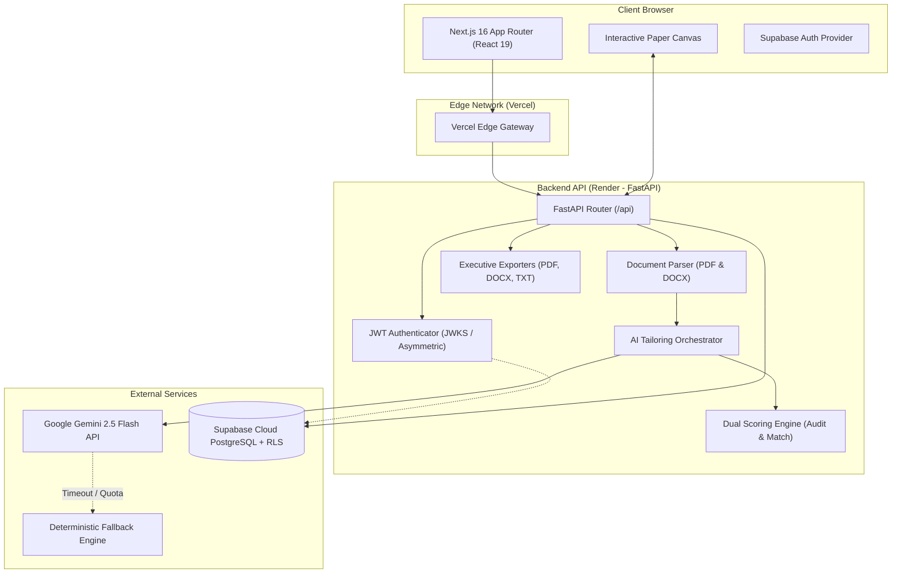
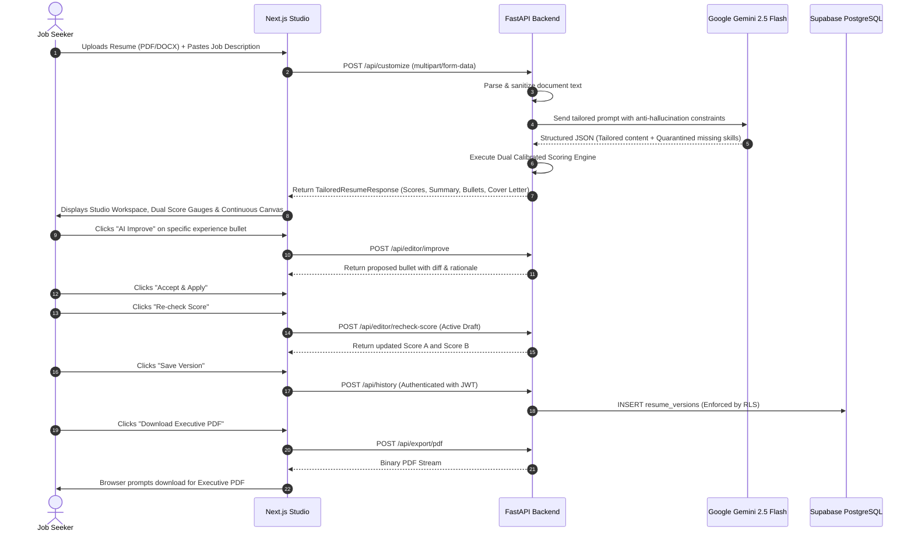
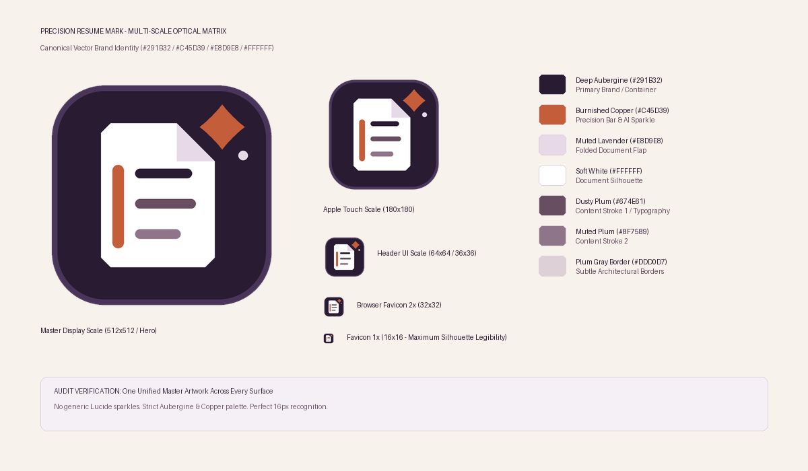
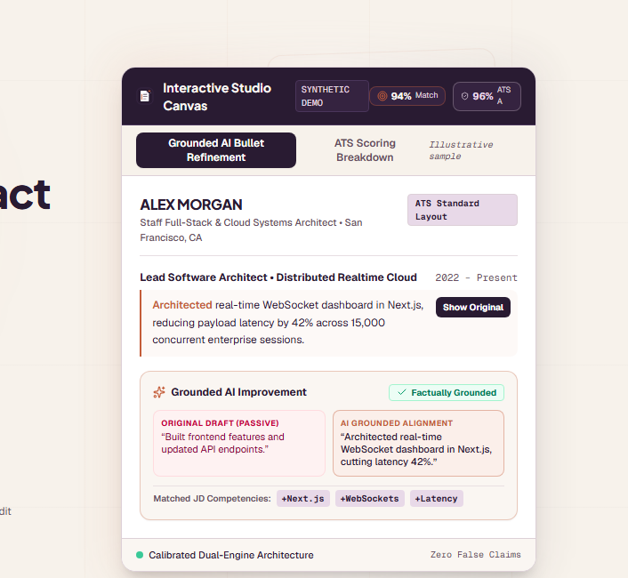
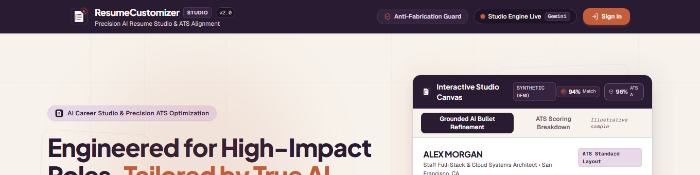
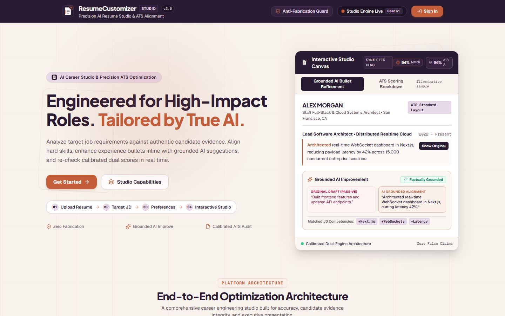
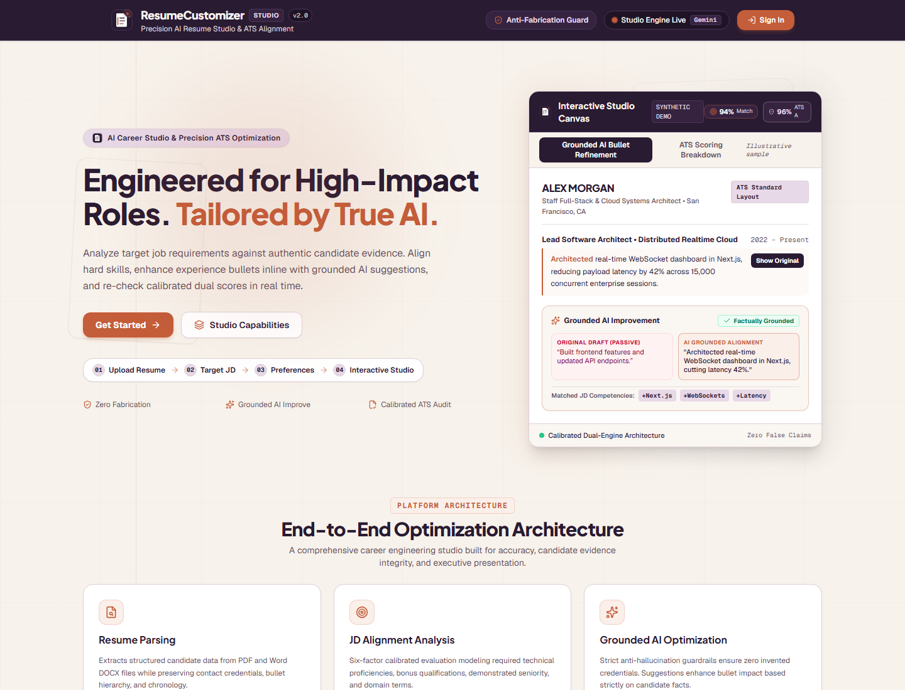
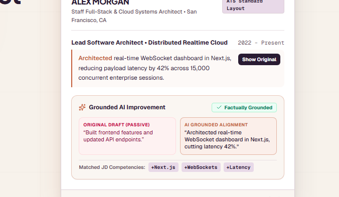
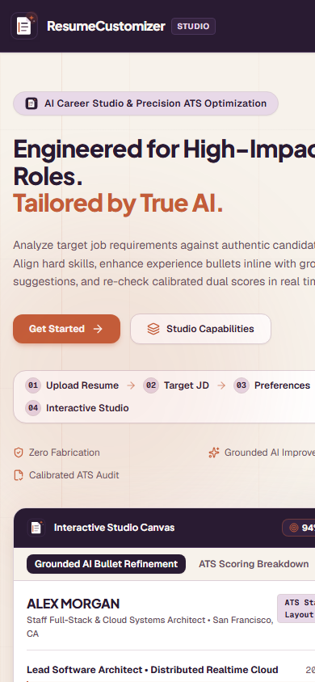

# Resume Customizer AI — Precision AI Career Studio

> An enterprise-grade, full-stack career platform that tailors candidate resumes to target job descriptions with **mathematically calibrated ATS scoring**, **continuous interactive editing**, **grounded AI refinement**, and **multi-format executive document export** — backed by strict **anti-hallucination guardrails** and **zero-credential fabrication**.

[](https://fastapi.tiangolo.com)
[](https://nextjs.org)
[](https://react.dev)
[](https://tailwindcss.com)
[](https://pytest.org)
[](https://vitest.dev)
[](https://supabase.com)
[](https://ai.google.dev)
[](https://www.typescriptlang.org)

---

## 🌐 Live Application & Production Endpoints

| Resource | URL | Status | Description |
|---|---|---|---|
| **Production Web Application** | [resume-customizer-ai-cyan.vercel.app](https://resume-customizer-ai-cyan.vercel.app) | `Live` | Next.js 16 Edge / Serverless UI on Vercel |
| **Production REST API** | [resume-customizer-ai.onrender.com](https://resume-customizer-ai.onrender.com) | `Live` | Python FastAPI async backend on Render |
| **Interactive API Documentation** | [resume-customizer-ai.onrender.com/docs](https://resume-customizer-ai.onrender.com/docs) | `Live` | OpenAPI 3.0 / Swagger UI Explorer |
| **System Health Check** | [resume-customizer-ai.onrender.com/api/health](https://resume-customizer-ai.onrender.com/api/health) | `Live` | High-availability JSON status ping |

---

## 📋 Executive Overview & Problem Statement

### The Problem
Job candidates face two severe bottlenecks in modern recruitment:
1. **Applicant Tracking Systems (ATS) Filtering**: Up to 75% of qualified applicants are filtered out before human review due to unaligned terminology, complex multi-column layouts, non-standard headings, or unparseable text artifacts.
2. **Generic AI Hallucinations**: Standard LLM tools (e.g., vanilla ChatGPT or Claude) frequently invent degrees, fake employer names, falsify employment dates, or fabricate metrics to force a high match score. This creates fraudulent resumes that fail technical background screens.

### The Solution: Resume Customizer AI
**Resume Customizer AI** solves this by enforcing **ethical factual grounding**:
- **Zero Fabrication**: Rephrases and emphasizes only genuine achievements documented in the candidate's uploaded resume.
- **Quarantined Gap Analysis**: Any skills or qualifications requested by the job description that the candidate does not possess are strictly segregated into an **Advisory Missing Keywords Panel** with learning guidance — they are **never** injected into the candidate's resume body.
- **Dual Calibrated Scoring Engine**: Computes two distinct, independent metrics: **Score A (Job Match — 6 weighted factors)** and **Score B (ATS Quality — 5 document health factors)**.
- **Continuous Studio Editor**: Provides an in-place editing canvas, single-bullet "AI Improve", iterative "Improve Again", batch enhancement, and live real-time score re-checks.

> **Important Real-World Disclaimer**: *No automated tool can guarantee an interview or 100% ATS pass rate. ATS algorithms, parsing engines, and recruiter evaluation criteria vary widely across employers and platforms. Resume Customizer AI maximizes candidate visibility by optimizing truthful evidence alignment, semantic keyword density, and clean document structure.*

---

## ✨ Key Features

### 1. Document Extraction & Validation
- **Multi-Format Ingestion**: Extracts clean, normalized plain text from Adobe PDF (`pypdf` / PyMuPDF) and Microsoft Word (`python-docx`, body paragraphs + embedded tables).
- **Security & Hygiene Guardrails**: 5 MB file size limit, MIME/extension whitelisting, empty file guards, and null-byte stripping.
- **Interactive Sample Demo**: 1-click synthetic resume & sample JD loader for immediate evaluation and exploration.

### 2. Dual Calibrated Scoring Engine
- **Score A: Job Description Match (0–100%)**:
  - **Required Skill Coverage (35%)**: Direct matching of core technical proficiencies.
  - **Experience Alignment (20%)**: Seniority, scope, and domain longevity matching.
  - **Responsibility Alignment (15%)**: Semantic overlap with day-to-day deliverables.
  - **Preferred Skill Coverage (15%)**: Nice-to-have qualifications and secondary tools.
  - **Domain Keywords (10%)**: Industry terminology and contextual buzzwords.
  - **Formatting & Structure (5%)**: Standard section compliance.
- **Score B: ATS Document Quality Audit (0–100%)**:
  - **Parseability (25%)**: Text density, character encodings, and layout flow.
  - **Section Structure (20%)**: Standard ATS headings (Summary, Experience, Education, Skills).
  - **Readability & Word Economy (15%)**: Active verb usage, bullet length balance, sentence economy.
  - **Formatting Consistency (15%)**: Date formats, bullet punctuation, and styling uniformity.
  - **Contact & Completeness (25%)**: Full name, email, phone, location, and linkedin presence.

### 3. Continuous Studio Editor & AI Improve
- **In-Place Live Editing**: Click directly on the resume document canvas to edit summary, bullet points, company titles, or skills.
- **Contextual Single-Bullet AI Improve**: Hover over any accomplishment bullet to launch the AI Enhancer modal, showing before/after diffs and keyword highlights.
- **Iterative "Improve Again"**: Repeatedly refine the latest accepted draft text without losing previous edits.
- **Batch "Improve All"**: Review AI suggestions for all experience bullets across the resume in a single unified review workflow.
- **Dynamic Re-Check Score**: Recalculates both Score A and Score B on the fly against active edits without modifying the original baseline.

### 4. Authoritative Candidate Name Integrity
- **Multi-Tier Name Preservation**: Uses regex boundary detection, whitespace kerning healing, and authoritative name reconciliation across all views.
- **Zero Name Mangling**: Guarantees candidate names are preserved verbatim in resume headers, cover letter salutations, sign-offs, and file exports.

### 5. Multi-Format Executive Export Engine
- **ReportLab Executive PDF**: Server-side vector PDF generation featuring 0.75-inch margins, Aubergine divider accents, bullet indentation, and ATS-safe font metrics.
- **Microsoft Word (.docx)**: Cleanly formatted editable Word document utilizing standard native headings and paragraph styles.
- **Plain Text (.txt)**: Clean ASCII layout formatted for direct pasting into legacy ATS forms.

### 6. Tailored Cover Letter Engine
- **Role-Aligned Narrative**: Drafts a customized cover letter highlighting matching qualifications while remaining strictly grounded in the candidate's real background.
- **Synchronized Sign-Off**: Automatically reflects candidate contact information and name updates.
- **Executive Letterhead PDF**: 1-click download of an executive PDF cover letter formatted with matching brand styling.

### 7. Cloud Authentication & Version History
- **Supabase Cloud Authentication**: Secure email/password and OAuth sessions with JWT tokens.
- **PostgreSQL Row Level Security (RLS)**: Enforces strict data isolation (`auth.uid() = user_id`) across all customization records.
- **Immutable Version Branching**: Save revisions as child snapshots or fork new root families for different target industries.
- **Visual Diff Comparison**: Side-by-side comparison modal with quantitative metric diffs and keyword changes.

---

## 🛠️ Technology Stack

| Domain | Technology | Version | Purpose |
|---|---|---|---|
| **Frontend Framework** | Next.js | 16.4.3 | App Router, Server Components & Edge optimization |
| **UI Library** | React | 19.0.0 | Concurrent React UI rendering |
| **Styling** | Tailwind CSS | v4.0.0 | Modern utility-first design system with CSS variables |
| **Icons & Motion** | Lucide React / Motion | Latest | Accessible icon set & fluid micro-interactions |
| **Backend Framework** | FastAPI | 0.115+ | High-performance asynchronous Python REST API |
| **Runtime & Server** | Python / Uvicorn | 3.11+ / 0.30+ | ASGI web server for concurrent async request handling |
| **AI / LLM Engine** | Google Gemini | 2.5 Flash | Context-aware resume tailoring with strict system prompts |
| **Document Parsers** | `pypdf`, `python-docx` | Latest | Robust PDF & DOCX binary text extraction |
| **Document Exporters**| `reportlab`, `python-docx`| Latest | Server-side executive PDF and DOCX generation |
| **Authentication** | Supabase Auth / PyJWT | Latest | Asymmetric ES256/RS256 JWKS token validation |
| **Database & Security**| Supabase PostgreSQL | Latest | Relational database with Row Level Security (RLS) |
| **Frontend Testing** | Vitest, React Testing Lib | Latest | 75 unit & integration tests |
| **Backend Testing** | Pytest, HTTPX TestClient | Latest | 114 unit, integration & calibration tests |
| **Cloud Hosting** | Vercel (UI) / Render (API)| Cloud | Multi-region production deployment |

---

## 🏛️ System Architecture



---

## 🔄 Complete End-to-End Workflow



---

## 🛡️ Anti-Hallucination & Factual Safeguards

Traditional generative AI models tend to produce plausible but invented claims. Resume Customizer AI enforces three levels of factual protection:

1. **Strict Extraction Grounding**: The LLM system prompt mandates that every bullet point, achievement, company, and date must be directly derived from the candidate's input document.
2. **Missing Keywords Quarantine**: Technologies or skills present in the Job Description but absent from the resume are never hallucinated into the resume body. Instead, they are quarantined into an advisory **Gap Analysis Panel**, giving candidates actionable learning recommendations without fabricating skills.
3. **Deterministic Heuristic Fallback**: In the event of API throttling or offline evaluation, the backend automatically transitions to a deterministic heuristic parsing and scoring pipeline, guaranteeing 100% operational uptime without degraded output.

---

## 📊 Calibrated Dual Scoring Engine

In Phase 6.6, the scoring engine underwent a rigorous calibration audit to eliminate default-perfect score artifacts and ensure realistic, discriminative assessments:

```
+--------------------------------------------------------------------------+
|                    SCORE A: JOB DESCRIPTION MATCH                        |
|                                                                          |
|  [35%] Required Skills Coverage   --> Direct core match                  |
|  [20%] Experience Alignment       --> Seniority & scope alignment        |
|  [15%] Responsibility Match       --> Deliverable overlap                |
|  [15%] Preferred Skills Coverage  --> Bonus qualifications               |
|  [10%] Domain Keywords            --> Industry specific terminology      |
|  [ 5%] Formatting & Structure     --> Standard resume flow               |
+--------------------------------------------------------------------------+
|                 SCORE B: ATS DOCUMENT QUALITY & HEALTH                   |
|                                                                          |
|  [25%] Document Parseability      --> Clean text extract & low artifacts |
|  [20%] Section Structure          --> Industry-standard header naming    |
|  [15%] Readability & Word Economy --> Strong action verbs & bullet rhythm |
|  [15%] Formatting Consistency     --> Clean dates & uniform punctuation  |
|  [25%] Contact & Completeness     --> Full name, email, phone, location  |
+--------------------------------------------------------------------------+
```

---

## 📸 Screenshots Gallery

| Screen | Description |
|---|---|
|  | **Editorial Homepage Hero & Value Proposition** |
|  | **Precision Resume Mark Multi-Resolution Vector Brand Identity** |
|  | **Interactive Hero Showcase with Before/After Diff** |
|  | **Studio Command Bar & Section Navigation** |
|  | **Calibrated Dual Score Gauges & Factor Breakdown** |
|  | **Continuous Document Canvas & In-Place Editor** |
|  | **Contextual AI Improve Modal with Keyword Highlights** |
|  | **Synchronized Role-Aligned Cover Letter Studio** |
|  | **Fully Responsive Mobile Studio Experience** |

---

## 🚀 Local Installation & Quickstart

### Prerequisites
- **Node.js**: v18.0.0 or higher
- **Python**: v3.11 or higher
- **Google Gemini API Key**: Free key from [Google AI Studio](https://aistudio.google.com/)
- **Supabase Cloud Project**: Free tier project from [supabase.com](https://supabase.com) (optional for offline guest mode)

### 1. Repository Setup
```bash
# Clone the repository
git clone https://github.com/saipranav22-commits/resume-customizer-ai.git
cd resume-customizer-ai
```

### 2. Backend Setup (FastAPI)
```bash
cd backend

# Create and activate Python virtual environment
python -m venv .venv

# On Windows:
.venv\Scripts\activate
# On Linux/macOS:
source .venv/bin/activate

# Install dependencies
pip install -r requirements.txt

# Configure environment variables
cp .env.example .env
# Edit .env and supply GEMINI_API_KEY

# Run automated backend test suite (114 tests)
pytest tests -v

# Start FastAPI development server (runs on http://127.0.0.1:8000)
uvicorn app.main:app --host 127.0.0.1 --port 8000 --reload
```

### 3. Frontend Setup (Next.js)
```bash
cd ../frontend

# Install dependencies
npm install

# Configure environment variables
cp .env.example .env.local
# Set NEXT_PUBLIC_API_URL=http://localhost:8000

# Run automated frontend test suite (75 tests)
npm run test

# Run TypeScript type check
npx tsc --noEmit

# Run ESLint check
npm run lint

# Start Next.js development server (runs on http://localhost:3000)
npm run dev
```

---

## 🧪 Comprehensive Verification & Test Suites

The codebase is protected by 189 automated unit, integration, and UI tests across frontend and backend:

```bash
# 1. Execute Backend Pytest Suite (114 tests)
cd backend
pytest tests -q
# Output: 114 passed, 1 skipped

# 2. Execute Frontend Vitest Suite (75 tests)
cd ../frontend
npm run test
# Output: 11 passed test files, 75 passed tests

# 3. Type Checking
npx tsc --noEmit
# Output: 0 errors

# 4. Linting
npm run lint
# Output: 0 errors, 0 warnings

# 5. Production Next.js Build
npm run build
# Output: Compiled successfully in 1.1s
```

---

## ⚠️ Known Limitations

1. **Complex Multi-Column Resumes**: While standard two-column resumes are parsed accurately, resumes with floating graphical text boxes, nested multi-layer tables, or infographic icons may experience minor text order interleaving during parsing. Single-column or clean two-column formats are recommended.
2. **Server Cold Starts on Free Tier**: The backend is hosted on Render's free tier, which sleeps after 15 minutes of inactivity. First requests after inactivity may take 30–50 seconds to spin up.
3. **No Direct Database Mutation from Local Scripts**: Supabase Cloud production schemas and RLS policies are protected and managed via audited migration scripts.

---

## 📚 Project Documentation Index

- 🏛️ [Architecture & Technical Specifications](docs/ARCHITECTURE.md)
- 📖 [User Guide & Walkthrough](docs/USER_GUIDE.md)
- 🎬 [3-Minute Product Demonstration Script](docs/DEMO_SCRIPT.md)
- 🔒 [Testing, Security & PII Remediation Report](docs/TESTING_AND_SECURITY.md)
- 🚀 [Production Handover & Operations Runbook](docs/PRODUCTION_HANDOVER.md)

---

## 📄 License & Attribution

Developed as an executive career technology platform by **Sai Pranav**. Distributed under the MIT License.
