# Resume Customizer AI — Precision AI Career Studio

> An enterprise-grade, full-stack career platform that tailors candidate resumes to target job descriptions with **mathematically calibrated ATS scoring**, **continuous interactive editing**, **grounded AI refinement**, and **multi-format executive document export** — backed by strict **anti-hallucination guardrails** and **zero-credential fabrication**.

[](https://fastapi.tiangolo.com)
[](https://nextjs.org)
[](https://react.dev)
[](https://tailwindcss.com)
[](https://pytest.org)
[](https://vitest.dev)
[](https://supabase.com)
[](https://ai.google.dev)
[](https://www.typescriptlang.org)
[](https://opensource.org/licenses/MIT)

---

## 🌐 Live Application & Production Endpoints

| Resource | URL | Status | Description |
|---|---|---|---|
| **Production Web Application** | [resume-customizer-ai-cyan.vercel.app](https://resume-customizer-ai-cyan.vercel.app) | `Live` | Next.js 16 Edge / Serverless UI on Vercel |
| **Official YouTube Walkthrough** | [youtu.be/IzA88JnyOn4](https://youtu.be/IzA88JnyOn4) | `Live` | 5m 52s Full Technical Walkthrough & Architecture Tour |
| **Production REST API** | [resume-customizer-ai.onrender.com](https://resume-customizer-ai.onrender.com) | `Live` | Python FastAPI async backend hosted on Render |
| **Interactive API Documentation** | [resume-customizer-ai.onrender.com/docs](https://resume-customizer-ai.onrender.com/docs) | `Live` | OpenAPI 3.0 / Swagger UI Explorer |
| **System Health Check** | [resume-customizer-ai.onrender.com/api/health](https://resume-customizer-ai.onrender.com/api/health) | `Live` | High-availability JSON status probe (`{"status":"healthy"}`) |
| **GitHub Source Code** | [github.com/saipranav22-commits/resume-customizer-ai](https://github.com/saipranav22-commits/resume-customizer-ai) | `Live` | Full-stack monorepo (Next.js, FastAPI, Tests) |

---

## 🎬 Video Demonstration Walkthrough

[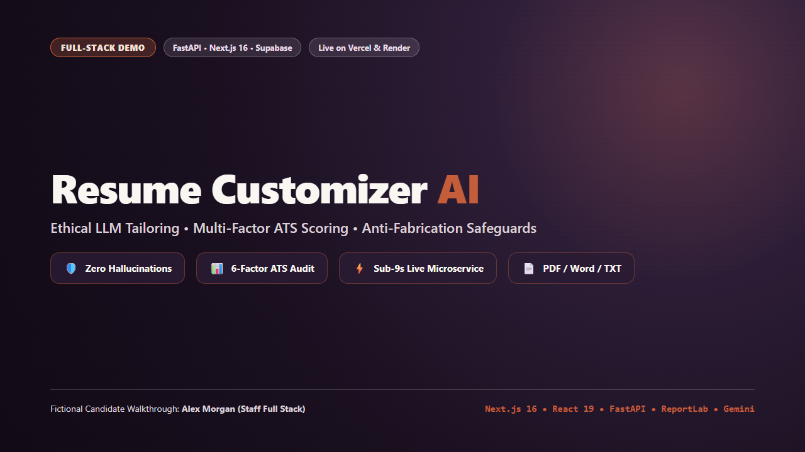](https://youtu.be/IzA88JnyOn4)

> **Full Technical Walkthrough (5m 52s)**: Watch an end-to-end demonstration of Resume Customizer AI running live against the production deployment, featuring resume uploads, job description analysis, AI optimization, ATS evaluation, interactive editing, and document export.

### ⏱️ Video Chapters & Timestamps

- **`00:00` — Introduction and Problem Statement**: ATS filtering challenges and generative AI hallucination risks.
- **`00:32` — Architecture and Technology Stack**: Next.js 16, React 19, FastAPI, Supabase PostgreSQL, and Google Gemini.
- **`01:21` — Resume Upload and Document Parsing**: PyPDF & python-docx extraction with pre-flight sanitization.
- **`01:59` — Job Description Input**: 50-character validation counter, sample loader, and granular section controls.
- **`02:31` — AI Resume Optimization Pipeline**: 6-stage asynchronous pipeline completing in under 9 seconds.
- **`03:03` — Interactive Editing Studio**: Continuous paper canvas, in-place DOM editing, and single-bullet AI improve.
- **`03:37` — ATS Quality Audit**: Mathematically calibrated dual scoring (Score A Job Match + Score B ATS Quality).
- **`04:15` — Skill-Gap Analysis**: Ethical anti-fabrication isolation of missing target skills into advisory guidance.
- **`04:46` — Before/After Comparison and Cover Letter**: Side-by-side diff view and role-aligned cover letter generator.
- **`05:15` — PDF, DOCX and TXT Export**: ReportLab vector PDF generation, Word DOCX, and plain text downloads.

---

## 📋 Project Overview

**Resume Customizer AI** is a production-grade full-stack engineering portfolio application that transforms how candidates prepare resumes for competitive software engineering opportunities. Instead of treating resume customization as a black-box text rewriting task, the application implements an **intelligent, explainable career studio** that evaluates candidate evidence, optimizes phrasing using targeted action verbs, computes realistic ATS quality metrics, and generates publication-grade documents in PDF, DOCX, and plain text formats.

The project demonstrates high-standard software engineering practices: typed frontend architectures in React 19 and Next.js 16, asynchronous Python microservices with FastAPI and Pydantic, resilient multi-cloud deployment across Vercel and Render, zero-trust asymmetric authentication with Supabase JWKS, and comprehensive test coverage (189 verified automated tests).

---

## 🎯 Problem Statement and Solution

### The Modern Hiring Bottlenecks

1. **Applicant Tracking System (ATS) Disqualification**: Up to 75% of qualified engineering applicants are filtered out before human review due to unaligned keywords, multi-column layouts, table nesting, or non-standard section headers that confuse automated parsers.
2. **Generative AI Hallucination & Fabrication**: Standard consumer LLMs (such as vanilla ChatGPT or Claude) frequently invent unearned degrees, fabricate previous employer names, or create unrealistic metrics to force a high match score. Resumes containing fabricated credentials create severe ethical liability and collapse during technical interviews and background checks.

### The Solution: Ethical Factual Grounding

Resume Customizer AI enforces strict **anti-fabrication guardrails**:

- **Zero Credential Fabrication**: Rephrases, reorders, and emphasizes only genuine achievements evidenced in the candidate's original document.
- **Quarantined Skill-Gap Analysis**: Skills or tools present in the target job description that the candidate does not possess are never injected into the resume body. They are strictly segregated into an **Advisory Missing Keywords Panel** with actionable recommendations on how to acquire or discuss those skills.
- **Dual Calibrated Scoring Engine**: Eliminates default-perfect score artifacts by computing two independent mathematical metrics: **Score A (Job Match — 6 weighted factors)** and **Score B (ATS Quality — 5 document health factors)**.
- **Continuous Studio Editor**: Provides an in-place editing paper canvas, single-bullet contextual "AI Improve", iterative "Improve Again", batch enhancement, and live real-time score re-checks.

> [!NOTE]
> **Heuristic Scoring Disclaimer**: *ATS scores generated by this application are objective, evidence-based heuristic estimates calibrated to standard parsing best practices. They do not represent official employer outcomes or guarantee interview invitations. Resume Customizer AI maximizes candidate visibility by optimizing truthful evidence alignment, semantic keyword density, and clean document structure.*

---

## ✨ Core Features

### 1. Dual-Format Document Parsing (PDF & DOCX)
- Robust binary extraction from Adobe PDF via `pypdf` stream decoding, whitespace kerning healing, and null-byte stripping.
- Extraction from Microsoft Word (`.docx`) body paragraphs and embedded tables using `python-docx`.
- Client-side and server-side validation enforcing a 5MB size limit, format whitelist, and minimum content thresholds.

### 2. Job Description Input & Real-Time Validation
- Interactive textarea with real-time character counting enforcing a 50-character minimum for meaningful analysis.
- Instant 1-click **"Load Sample JD"** button for immediate recruiter evaluation.
- Granular section customization toggles (Summary, Skills, Experience) allowing targeted optimization.

### 3. 6-Stage Asynchronous Optimization Pipeline
- Visual progression through 6 deterministic stages: Text Extraction → Structural Analysis → JD Comparison → AI Optimization → ATS Scoring → Multi-Format Assembly.
- Completes in under 9 seconds on Render containerized infrastructure.

### 4. Interactive Studio Editor & Continuous Paper Canvas
- In-place inline editing on an executive document paper canvas with typography hierarchy.
- Contextual hover controls on experience bullets launching the **AI Improve Modal**.
- Iterative **"Improve Again"** and batch **"Improve All"** capabilities operating on active drafts.
- Dynamic **Re-check Score** evaluating edits against the baseline without state drift.

### 5. Mathematically Calibrated Dual Scoring Engine
- **Score A (Job Description Match — 0 to 100%)**: Calibrated against 6 weighted factors (Required Skills 35%, Experience 20%, Responsibility 15%, Preferred Skills 15%, Domain Keywords 10%, Formatting 5%).
- **Score B (ATS Quality Audit — 0 to 100%)**: Calibrated against 5 document health factors (Parseability 25%, Section Structure 20%, Readability 15%, Formatting Consistency 15%, Contact Completeness 25%).
- Comprehensive Audit Findings modal identifying exact errors, warnings, and suggestions.

### 6. Side-by-Side Diff Comparison View
- Visual before-and-after change audit highlighting modified bullets, tailored summaries, and aligned keywords.
- Complete transparency showing exactly how the AI rephrased content while preserving truthful credentials.

### 7. Role-Tailored Cover Letter Generator
- Generates an executive, role-aligned cover letter highlighting genuine matching qualifications.
- 1-click clipboard copy and server-side executive letterhead PDF download.

### 8. Multi-Format Executive Document Exports
- **ReportLab Vector PDF**: Server-side binary generation with 0.75-inch margins, Aubergine divider accents, bullet indentation, and ATS-safe font metrics.
- **Microsoft Word (.docx)**: Cleanly formatted editable Word document using standard native headings and paragraph styles.
- **Plain Text (.txt)**: Clean ASCII layout formatted for direct pasting into legacy ATS forms.

### 9. Supabase Authentication & Multi-Version History
- Managed Supabase authentication supporting guest mode and persistent authenticated accounts.
- PostgreSQL Row Level Security (RLS) enforcing strict user isolation (`auth.uid() = user_id`).
- Immutable version history with child revisions, independent root forking, and side-by-side version comparison.

---

## 📸 Real Application Screenshots

### A. Application Overview

| 1. Landing Hero & Architecture | 2. Dual-Format Document Upload | 3. Target Job Description Input |
| :---: | :---: | :---: |
| [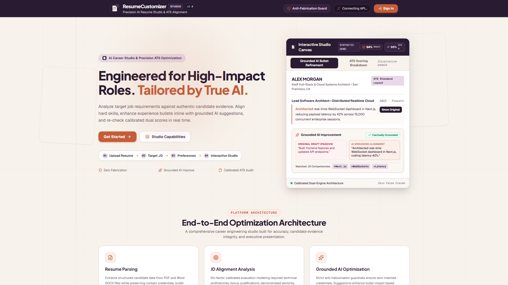](docs/screenshots/01_landing_hero.png) | [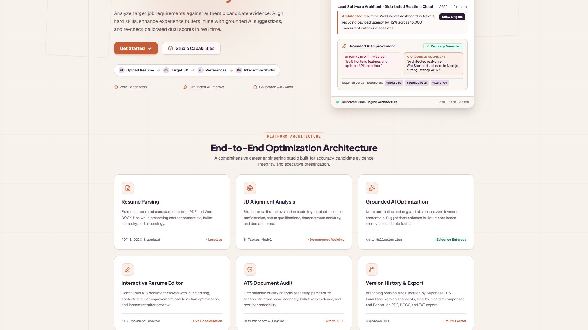](docs/screenshots/02_resume_upload.png) | [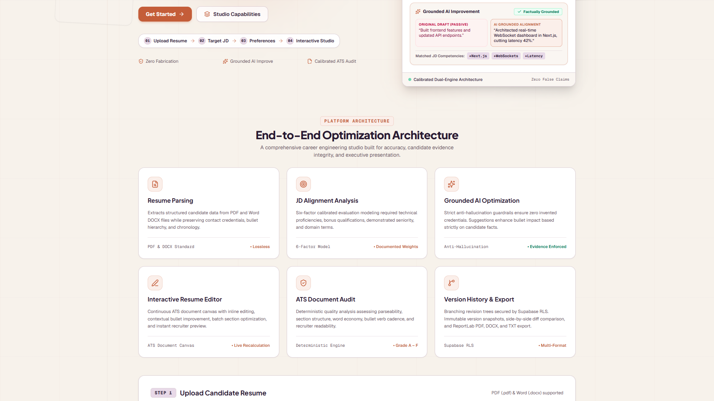](docs/screenshots/03_job_description_input.png) |
| *Editorial Aubergine & Copper hero with live backend status badge* | *Client-validated PDF/DOCX drag-and-drop dropzone with pre-flight checks* | *Interactive JD textarea with 50-char validation counter and sample loader* |

### B. AI Optimization Workflow

| 4. Asynchronous Pipeline State | 5. Interactive Studio Editor | 6. ATS Quality Audit & Re-check |
| :---: | :---: | :---: |
| [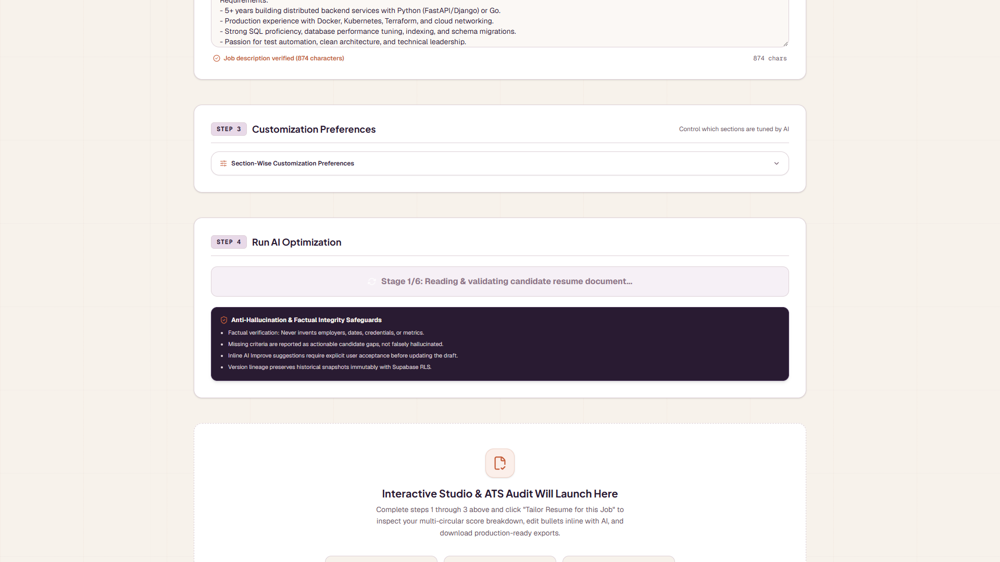](docs/screenshots/04_processing_state.png) | [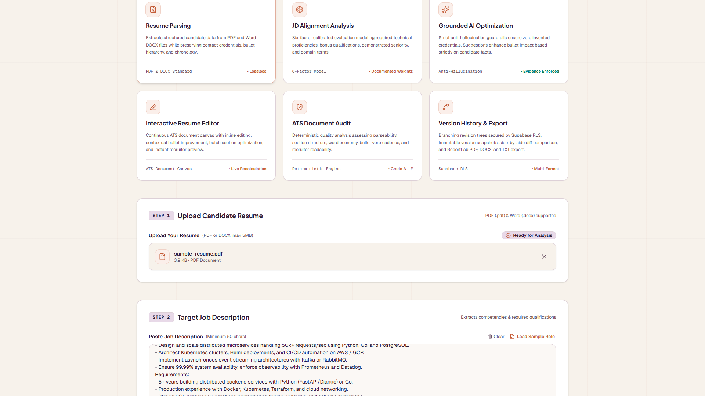](docs/screenshots/05_interactive_studio_editor.png) | [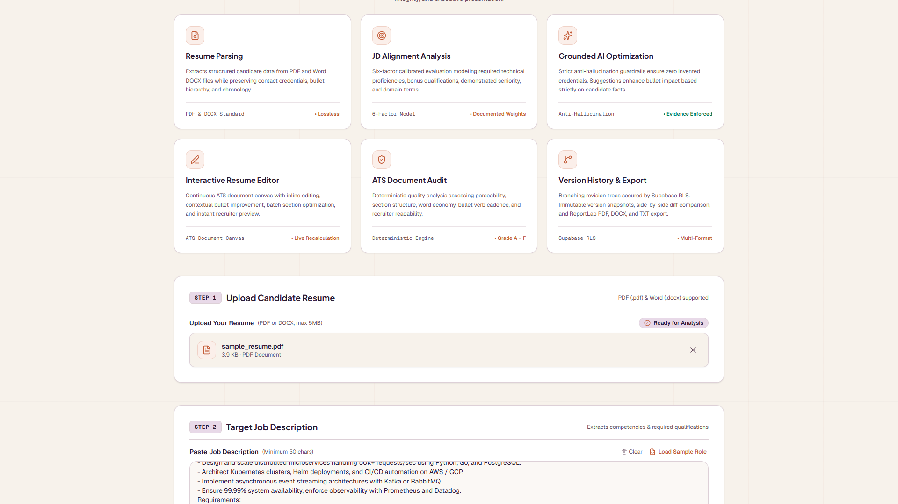](docs/screenshots/06_ats_quality_audit.png) |
| *6-stage animated progression tracking optimization under 9 seconds* | *Continuous paper canvas with in-place DOM editing and section toggles* | *Calibrated dual-score modal evaluating active edits against baseline* |

### C. Results and Editing

| 7. Missing Skills & Gap Analysis | 8. Side-by-Side Diff View | 9. Tailored Cover Letter Generator |
| :---: | :---: | :---: |
| [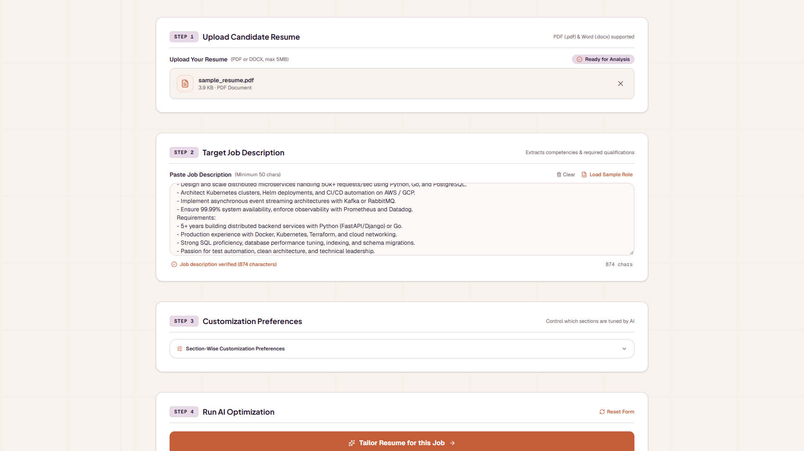](docs/screenshots/07_gap_analysis_recommendations.png) | [](docs/screenshots/08_diff_view_comparison.png) | [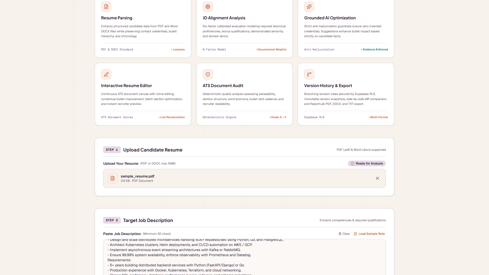](docs/screenshots/09_tailored_cover_letter.png) |
| *Ethical isolation of unverified candidate qualifications with guidance* | *Transparent comparison auditing rephrased bullets and added keywords* | *Synchronized cover letter with letterhead PDF export and 1-click copy* |

### D. Export and Responsiveness

| 10. Multi-Format Export Toolbar | 11. Version History & Revision Forking | 12. Mobile Responsive Studio |
| :---: | :---: | :---: |
| [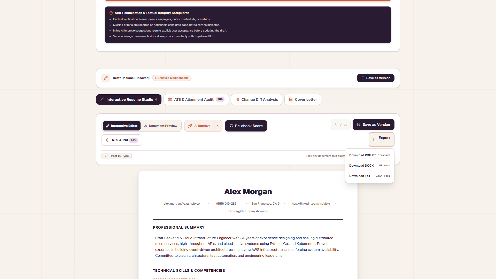](docs/screenshots/10_multi_format_exports.png) | [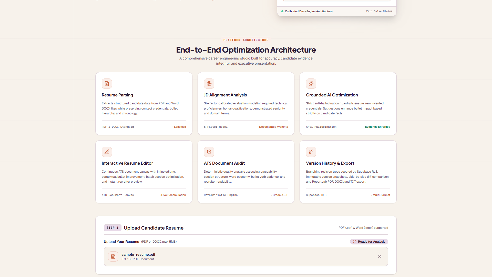](docs/screenshots/11_save_version_history.png) | [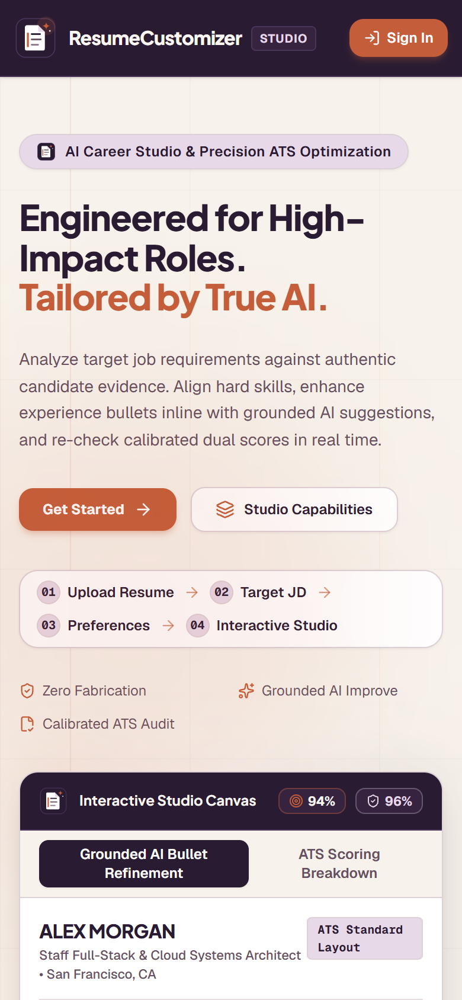](docs/screenshots/12_mobile_responsive_interface.png) |
| *Direct server-side binary downloads for ReportLab PDF, Word DOCX, and TXT* | *Supabase PostgreSQL revision tree with forking and version comparison* | *Fully responsive layout adapting to mobile viewports and touch controls* |

---

## 🛠️ Technology Stack

| Layer | Technology | Version | Architectural Role |
| :--- | :--- | :--- | :--- |
| **Frontend Framework** | **Next.js** | `16.4.3` | App Router, Server Components, and Edge-optimized routing |
| **UI Library** | **React** | `19.0.0` | Concurrent React UI with in-place content editable DOM state |
| **Language** | **TypeScript** | `5.x` | Strict type safety across document schemas, API responses, and studio state |
| **Styling** | **Tailwind CSS** | `v4.0.0` | Modern utility design with CSS custom properties (Aubergine `#291B32` & Copper `#C45D39`) |
| **Icons & Motion** | **Lucide React** / **Motion** | `1.61.0` / `14.6.0` | Accessible iconography and fluid micro-interactions |
| **Backend Framework** | **FastAPI** | `0.115+` | High-throughput asynchronous Python REST microservice |
| **ASGI Web Server** | **Uvicorn** | `0.34.0` | Production ASGI web server handling concurrent multipart requests |
| **Validation** | **Pydantic** | `2.6+` | Strict schema serialization and deserialization for LLM outputs |
| **AI / LLM Engine** | **Google Gemini** | `gemini-3.5-flash` | Context-aware resume tailoring with strict anti-fabrication prompts |
| **Resilience Engine** | **Regex / Heuristic NLP** | Internal | Deterministic offline fallback matcher ensuring 100% operational uptime |
| **Document Parsers** | **PyPDF** / **python-docx** | `5.3.0` / `1.1.2` | Binary Adobe PDF text decoding and Word document/table extraction |
| **Document Exporters**| **ReportLab Platypus** | `4.3.1` | Vector PDF generation with flowables, styles, and ATS typography |
| **Database & Auth** | **Supabase PostgreSQL** | Cloud | Managed relational database with Row Level Security (RLS) schemas |
| **JWT Verification** | **PyJWT** / **Cryptography** | `2.8.0` / `42.0.0` | Asymmetric ES256 JWKS token authentication without local database secrets |
| **Backend Testing** | **Pytest** / **HTTPX** | `8.3.4` / `0.28.1` | 114 automated unit, integration, parser, and calibration tests |
| **Frontend Testing** | **Vitest** / **Testing Library** | `5.0.5` / `16.3.3` | 75 automated unit and UI component tests across 11 test suites |
| **Deployment** | **Vercel** + **Render** | Cloud | Edge CDN frontend distribution with containerized backend services |

---

## 🏛️ High-Level System Architecture

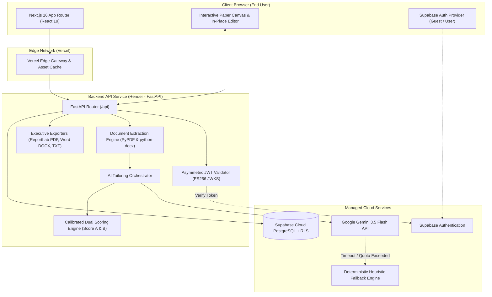

---

## 🔄 End-to-End User Workflow

```mermaid
flowchart LR
    A["1. Upload Resume (PDF / DOCX)"] --> B["2. Extract & Sanitize Text"]
    B --> C["3. Enter Target Job Description"]
    C --> D["4. 6-Stage Optimization Pipeline"]
    D --> E["5. Grounded LLM Customization"]
    E --> F["6. Quarantined Gap Analysis"]
    F --> G["7. Interactive Studio Canvas"]
    G --> H["8. Live Score Re-check"]
    H --> I["9. Save Revision (Supabase)"]
    I --> J["10. Export (PDF / DOCX / TXT)"]
```

---

## 🤖 AI and Resume Optimization Pipeline

The core AI engine coordinates a 6-stage asynchronous tailoring workflow designed to maximize target role alignment while strictly eliminating hallucinated claims:

1. **Extraction & Sanitization**: Raw document binary streams are decoded, null bytes stripped, line breaks normalized, and text structure mapped into structured sections.
2. **Structural Analysis**: Identifies candidate identity, contact information, professional summary, categorized skills, chronological experiences, education, and technical projects.
3. **Requirement Extraction**: Parses the target Job Description to identify hard technical requirements, preferred tools, seniority expectations, and domain deliverables.
4. **Context-Aware LLM Prompting**: Prompts Google Gemini with typed Pydantic output constraints (`TailoredResumeResponse`):
   - Rephrases bullet points to lead with strong action verbs (e.g., *Architected*, *Engineered*, *Optimized*).
   - Injects measurable outcomes and metrics where supported by candidate background.
   - Tailors the professional summary to position the candidate directly for the target title.
5. **Anti-Hallucination Skill Quarantine**: Skills present in the Job Description but absent from the candidate's verified background are strictly isolated into `missing_keywords`. They are never injected into the candidate's skills list or experience bullets.
6. **Deterministic Fallback Engine**: If Gemini is unreachable or rate-limited, the system executes a deterministic NLP heuristic matcher, guaranteeing zero user-facing 500 errors.

---

## 📊 ATS Quality Audit and Scoring

The platform implements a **Mathematically Calibrated Dual-Engine** to eliminate default-perfect score artifacts and deliver transparent, actionable evaluation:

```
+--------------------------------------------------------------------------+
|                    SCORE A: JOB DESCRIPTION MATCH                        |
|                                                                          |
|  [35%] Required Skills Coverage   --> Direct core technical match        |
|  [20%] Experience Alignment       --> Seniority & domain longevity       |
|  [15%] Responsibility Match       --> Overlap with daily deliverables    |
|  [15%] Preferred Skills Coverage  --> Secondary & bonus qualifications   |
|  [10%] Domain Keywords            --> Industry terminology & jargon      |
|  [ 5%] Formatting & Structure     --> Standard resume flow compliance    |
+--------------------------------------------------------------------------+
|                 SCORE B: ATS DOCUMENT QUALITY & HEALTH                   |
|                                                                          |
|  [25%] Document Parseability      --> Clean text extract & low artifacts |
|  [20%] Section Structure          --> Industry-standard header naming    |
|  [15%] Readability & Word Economy --> Strong action verbs & bullet rhythm |
|  [15%] Formatting Consistency     --> Clean dates & uniform punctuation  |
|  [25%] Contact & Completeness     --> Full name, email, phone, location  |
+--------------------------------------------------------------------------+
```

### Deterministic Quality Audit Findings

The audit engine scans for 12 concrete structural criteria:
- **Excessive Bullet Length**: Flags bullets exceeding 42 words or 280 characters.
- **Weak Starters**: Identifies bullets starting with passive verbs (e.g., *Helped with*, *Worked on*, *Responsible for*).
- **First-Person Pronouns**: Catches non-standard resume phrasing (*I*, *me*, *my*, *our*).
- **Date Inconsistencies**: Flags missing completion dates or non-standard date formatting.
- **Contact Details**: Checks for presence of email, phone number, location, and LinkedIn URLs.

---

## 🛡️ Anti-Fabrication and Skill-Gap Safeguards

A major hazard in modern resume AI tooling is "credential fabrication" — generating claims that a candidate has worked with frameworks, held certifications, or achieved metrics they never earned.

Resume Customizer AI enforces three immutable architectural safeguards:

1. **Extraction-Only Grounding**: The system prompt strictly limits resume claims to facts present in the uploaded document.
2. **Isolated Gap Analysis Panel**: Any skill in the target Job Description not verified on the resume is segregated into an advisory panel. Candidates receive honest guidance on how to address skill gaps (e.g., through coursework, GitHub portfolio projects, or transparent cover letter narratives).
3. **Transparent Diff Auditing**: Every modification made by the AI is displayed in a comparative Before vs. After diff view, enabling candidates to verify every word before exporting.

---

## 🎨 Interactive Resume Studio

The studio provides an in-place editing experience mimicking desktop document software:

- **Continuous Paper Canvas**: Renders an executive document layout with authentic typography, divider rules, and badge formatting.
- **DOM Content Editable**: Click directly into any text block (summary, experience bullets, job titles, or skills) to make immediate adjustments.
- **Single-Bullet "AI Improve"**: Hover over any bullet to trigger the AI Enhancer, providing before/after diffs, upgraded action verbs, and keyword alignment.
- **Iterative "Improve Again"**: Refine the latest accepted draft text repeatedly without reverting previous manual edits.
- **Live Re-Check Score**: Re-evaluates Score A and Score B against the active modified draft in real-time.

---

## 📄 Document Parsing and Export

### Binary Extraction Pipeline
- **PDF Extraction**: `pypdf.PdfReader` with stream decoding, stripping null bytes, normalizing CRLF line breaks, and healing fragmented words.
- **DOCX Extraction**: `python-docx` extracting both standard body paragraphs and embedded tabular layouts.

### Server-Side Multi-Format Generation
- **ReportLab Executive PDF**: Built using `reportlab.platypus` with custom `ParagraphStyle` hierarchies, 0.75-inch margins, Auburn divider lines, and clean bullet indents.
- **Microsoft Word (.docx)**: Generated via `python-docx` using standard native heading styles for universal compatibility.
- **Plain Text (.txt)**: Structured ASCII output suitable for direct copy-pasting into legacy enterprise ATS forms.

---

## 🔌 Backend API Documentation

| Method | Endpoint | Request Payload | Response | Description |
|---|---|---|---|---|
| `GET` | `/api/health` | None | `HealthResponse` | Returns service health, version, and LLM configuration |
| `POST` | `/api/customize` | `multipart/form-data`: `resume`, `job_description`, section toggles | `TailoredResumeResponse` | Parses document, runs LLM customization, and returns tailored resume |
| `POST` | `/api/editor/improve` | `ImproveTextRequest`: `text`, `section_type`, `job_description` | `ImproveTextResponse` | Generates targeted single-bullet improvement proposal |
| `POST` | `/api/editor/recheck-score` | `RecheckScoreRequest`: `resume_data`, `job_description` | `RecheckScoreResponse` | Re-evaluates Score A and Score B against active studio draft |
| `POST` | `/api/export/pdf` | `TailoredResumeResponse` JSON | `application/pdf` binary | Generates and downloads styled executive PDF resume |
| `POST` | `/api/export/docx` | `TailoredResumeResponse` JSON | `application/vnd.openxmlformats` | Generates and downloads Microsoft Word DOCX resume |
| `POST` | `/api/export/txt` | `TailoredResumeResponse` JSON | `text/plain` binary | Generates and downloads plain text resume |
| `POST` | `/api/export/cover-letter/pdf` | `CoverLetterPdfRequest` JSON | `application/pdf` binary | Generates styled executive letterhead PDF cover letter |
| `GET` | `/api/history` | Bearer Token in `Authorization` header | `List[ResumeVersionResponse]` | Lists user's saved resume versions and revision families |
| `POST` | `/api/history` | `SaveVersionRequest` JSON + Bearer Token | `ResumeVersionResponse` | Saves new resume version snapshot with RLS enforcement |

---

## 🔐 Supabase Authentication and Database Architecture

### Relational Schema (PostgreSQL)

```sql
-- Profiles table linked to Supabase Auth
create table if not exists public.profiles (
  id uuid references auth.users on delete cascade primary key,
  email text,
  full_name text,
  created_at timestamptz default now()
);

-- Saved Resumes and Multi-Version History
create table if not exists public.resume_versions (
  id uuid default gen_random_uuid() primary key,
  user_id uuid references auth.users on delete cascade not null,
  parent_version_id uuid references public.resume_versions(id) on delete set null,
  version_name text not null,
  target_role text,
  match_score integer,
  ats_score integer,
  resume_data jsonb not null,
  is_starred boolean default false,
  created_at timestamptz default now()
);

-- Row Level Security (RLS) Policies
alter table public.profiles enable row level security;
alter table public.resume_versions enable row level security;

create policy "Users can only access their own versions"
  on public.resume_versions
  for all using (auth.uid() = user_id);
```

### Asymmetric JWKS Authentication
The FastAPI backend validates incoming Supabase JWT tokens using asymmetric **ES256 / RS256 public keys** fetched directly from Supabase's OpenID JWKS endpoint (`/.well-known/jwks.json`). This ensures that the backend never requires or stores database service role secrets.

---

## ☁️ Deployment Architecture — Vercel + Render + Supabase

```mermaid
flowchart TD
    subgraph Users ["Global Candidates & Recruiters"]
        Browser["Modern Web Browser"]
    end

    subgraph VercelEdge ["Vercel Edge Network (Global CDN)"]
        FrontendEdge["Next.js 16 Edge / Serverless Runtime"]
    end

    subgraph RenderPlatform ["Render Cloud Platform (US-East)"]
        DockerService["FastAPI Container Service (Python 3.11)"]
        HealthProbe["Automated Health Monitor (/api/health)"]
    end

    subgraph SupabasePlatform ["Supabase Cloud Platform"]
        SupaAuth["Supabase GoTrue Auth Service"]
        SupaPostgres[("PostgreSQL 15 Database (RLS Enforced)")]
    end

    subgraph GoogleCloud ["Google Cloud AI"]
        GeminiAPI["Gemini 3.5 Flash Model Endpoint"]
    end

    Browser -->|HTTPS / WSS| FrontendEdge
    FrontendEdge -->|REST API / JSON| DockerService
    FrontendEdge -.->|Auth SDK / OAuth| SupaAuth
    DockerService -->|ES256 JWKS Validation| SupaAuth
    DockerService -->|SQL Query (RLS)| SupaPostgres
    DockerService -->|LLM Inference Request| GeminiAPI
    HealthProbe -->|Health Check 200 OK| DockerService
```

- **Frontend (Vercel)**: Next.js 16 App Router deployed with automatic edge caching and gzip/brotli asset compression.
- **Backend (Render)**: Containerized Docker FastAPI service running Uvicorn with auto-restart and zero-downtime rolling deploys.
- **Database (Supabase)**: Managed PostgreSQL 15 with automated snapshots, point-in-time recovery, and RLS data policies.

---

## 🧪 Testing and Verification

The repository is protected by **189 automated tests** verifying full-stack functionality across unit, parser, export, scoring, UI, and live cloud integration layers:

```
Test Suites Summary:
├── Backend Pytest Suite:  114 passed, 1 skipped (0 failures)
└── Frontend Vitest Suite:  75 passed across 11 test files (0 failures)
    └── TOTAL:             189 automated tests passed
```

### 1. Backend Automated Tests (114 Passed)
```bash
cd backend
python -m pytest tests -v
```
- `test_advanced_optimization.py`: Prompt injection sanitization, structured extraction, weight redistribution, and anti-hallucination assertions.
- `test_parser.py`: PDF stream normalization, DOCX table extraction, 5MB size limit validation, format whitelist enforcement.
- `test_exporter.py`: ReportLab PDF magic bytes (`%PDF`), Word ZIP headers (`PK`), and ASCII plain text generation.
- `test_editor_api.py`: Single-bullet improve endpoint, weak verb upgrading, recheck score sensitivity, and invalid payload handling.
- `test_scoring_calibration.py`: Mathematical weight verification across all 6 match factors and 5 ATS health factors.
- `test_auth_history.py`: Asymmetric ES256 JWKS validation, tamper rejection, RLS cross-user isolation, and SQLite production fallback guards.
- `test_live_api.py`: Mandatory live integration test verifying the deployed production backend at `https://resume-customizer-ai.onrender.com`.

### 2. Frontend Automated Tests (75 Passed)
```bash
cd frontend
npm run test
```
- `InteractiveResumeEditor.test.tsx`: In-place canvas editing, section additions, dirty draft tracking, and score re-check triggers.
- `Phase6_4_InlineEditor.test.tsx`: Inline document editing, contextual AI improve controls, and repeatable "Improve Again" stability.
- `ATSResumeEngine.test.tsx`: ATS audit modal launch, dual-score breakdown display, and fresher-adaptive layout rendering.
- `HistoryDrawer.test.tsx`: Revision grouping, search filtering, version forking, metadata updates, and version deletion.
- `VersionComparisonModal.test.tsx`: Two-version metric diff calculations and visual card side-by-side rendering.

---

## 🚀 Local Installation & Quickstart

### Prerequisites
- **Node.js**: v18.0.0 or higher
- **Python**: v3.11 or higher
- **Git**
- **Google Gemini API Key**: Free key from [Google AI Studio](https://aistudio.google.com/)
- **Supabase Cloud Project**: Free tier from [supabase.com](https://supabase.com) (optional; guest mode runs offline)

### 1. Clone Repository
```bash
git clone https://github.com/saipranav22-commits/resume-customizer-ai.git
cd resume-customizer-ai
```

### 2. Backend Setup (FastAPI)
```bash
cd backend

# Create and activate Python virtual environment
python -m venv .venv

# On Windows:
.venv\Scripts\activate
# On Linux/macOS:
source .venv/bin/activate

# Install dependencies
pip install -r requirements.txt

# Configure environment variables
cp .env.example .env
# Edit .env and supply your GEMINI_API_KEY

# Run backend tests
python -m pytest tests -v

# Start FastAPI server (runs on http://127.0.0.1:8000)
uvicorn app.main:app --host 127.0.0.1 --port 8000 --reload
```

### 3. Frontend Setup (Next.js)
```bash
cd ../frontend

# Install dependencies
npm install

# Configure environment variables
cp .env.example .env.local
# Set NEXT_PUBLIC_API_URL=http://localhost:8000

# Run frontend tests
npm run test

# Run type check and lint
npx tsc --noEmit
npm run lint

# Start Next.js development server (runs on http://localhost:3000)
npm run dev
```

Visit **`http://localhost:3000`** in your browser to experience the application.

---

## 💡 Key Engineering Challenges and Solutions

### 1. Eliminating Generative AI Credential Hallucination
* **Challenge**: Standard LLM prompting frequently invents missing degrees, certifications, or tools when optimizing resumes to achieve higher match percentages.
* **Solution**: Implemented a two-tier extraction and quarantine pattern. The system prompt restricts bullet claims to verified facts extracted from the uploaded document. Unverified skills from the Job Description are strictly segregated into a dedicated `missing_keywords` schema, ensuring fabricated qualifications never enter candidate resume drafts.

### 2. Dual-Engine ATS Calibration & Eliminating Default Score Bias
* **Challenge**: Early ATS prototypes often awarded default scores above 90% even for mismatched candidates due to uncalibrated keyword frequency matching.
* **Solution**: Re-engineered the scoring engine into two mathematically calibrated metrics: Score A (6 weighted job match factors totaling 100%) and Score B (5 document quality factors totaling 100%). Scoring tests assert sensitivity to both skill additions and layout deficiencies.

### 3. Asymmetric JWT Authentication with Zero Local Secrets
* **Challenge**: Traditional microservice authentication requires sharing database JWT secret keys between the auth provider and backend, creating secret rotation risks.
* **Solution**: Configured PyJWT with cryptography to fetch and cache Supabase's public JSON Web Key Set (`/.well-known/jwks.json`). The backend validates ES256 token signatures asymmetrically, eliminating local database secret storage.

### 4. Continuous In-Place Studio Canvas with Zero State Drift
* **Challenge**: Enabling users to click directly into a rendered document canvas, edit bullets, invoke AI improvements, and re-check scores without overwriting unsaved changes or losing baseline references.
* **Solution**: Implemented an immutable draft hierarchy in React 19. Edits are tracked in active draft state while preserving original baseline snapshots, allowing repeatable "Improve Again", single-bullet diffs, and side-by-side version comparison without state mutation.

### 5. Resilient Multi-Format Binary Document Assembly
* **Challenge**: Exporting consistent, professional typography across vector PDF, Word DOCX, and plain text formats while handling special XML characters, bullet indentation, and page break constraints.
* **Solution**: Developed dedicated server-side exporter services. ReportLab Platypus constructs flowable vector PDFs with strict margin and leading rules. `python-docx` applies standard Word heading styles, and ASCII text exports are cleanly delimited.

---

## ⚠️ Known Limitations

1. **Complex Multi-Column Resumes**: While standard single-column and two-column resumes parse cleanly, resumes with floating graphical text boxes, nested multi-layer tables, or non-standard infographic icons may experience text ordering interleaving. Clean single-column formats are recommended.
2. **Server Cold Starts on Free Tier**: The backend is hosted on Render's free tier, which sleeps after 15 minutes of inactivity. Initial requests after dormancy may take 30–50 seconds to spin up.
3. **Heuristic Evaluation**: ATS scores are application-calculated heuristic estimates based on parsing standards; they are not official outcomes from proprietary employer ATS vendors.

---

## 🔮 Future Improvements

1. **LaTeX Document Compilation Engine**: Direct server-side compilation of LaTeX source code for academic and scientific technical resumes.
2. **Automated Application Kanban Board**: Integrated tracking board allowing candidates to track application stages (Applied, Screen, Technical Interview, Offer).
3. **Multi-Job Description Comparison Matrix**: Upload multiple job descriptions simultaneously to identify overlapping skills across an entire job search campaign.
4. **Direct GitHub / Portfolio Repository Indexer**: Connect public GitHub repositories to verify code evidence and automatically draft portfolio project bullet points.

---

## 📄 License & Attribution

Developed by **Sai Pranav** as an executive full-stack career platform. Distributed under the **MIT License**.
